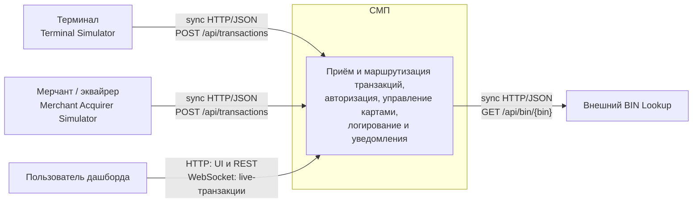

# A1. C4 Level 1 — Context

## Чего не хватало

> В `docs/architecture.md` есть общая mermaid-схема, но отдельной Context-диаграммы нет: границы «СМП vs внешний мир» явно не проведены. Нужно явно перечислить акторов и протоколы их входа.

Это соответствует исходному состоянию проекта именно в части отдельной C4 Context-диаграммы. Общая схема уже содержала Terminal Simulator, Merchant Simulator, Dashboard и BIN Lookup, но не показывала СМП единым «чёрным ящиком» с явно проведённой системной границей и полным перечнем внешних акторов и протоколов.

## Что сделано

**Context diagram:**

По коду мы видим, что:

- Терминал отправляет транзакции в Gateway: [`GatewayClient.java`](../../../services/terminal-simulator/src/main/java/com/processing/terminalsimulator/client/GatewayClient.java).
- Merchant Acquirer отправляет транзакции в Gateway: [`GatewayClient.java`](../../../services/merchant-acquirer/src/main/java/com/processing/merchantacquirer/client/GatewayClient.java).
- Dashboard обращается к REST API и открывает WebSocket: [`useTransactions.ts`](../../../services/dashboard/src/hooks/useTransactions.ts), [`useWebSocket.ts`](../../../services/dashboard/src/hooks/useWebSocket.ts).
- Authorization обращается к BIN Lookup по HTTP: [`BinLookupClient.java`](../../../services/authorization/src/main/java/com/processing/authorization/client/BinLookupClient.java).
- Адреса и контейнеры локальных эмуляторов заданы в [`docker-compose.yaml`](../../../docker-compose.yaml).

Я разделила внутренний контур самой системы СМП и внешних акторов, и указала для них протоколы входа. 
Terminal Simulator, Merchant Acquirer Simulator и BIN Lookup эмулируют внешние системы. 

При помощи этой диаграммы в будущем сможем сказать, что входит в область тестирования, а что нет. Всё, что снаружи, — это акторы, которых мы при E2E-тестировании либо эмулируем (Terminal Simulator, Merchant Simulator), либо заглушаем (внешний BIN Lookup).

