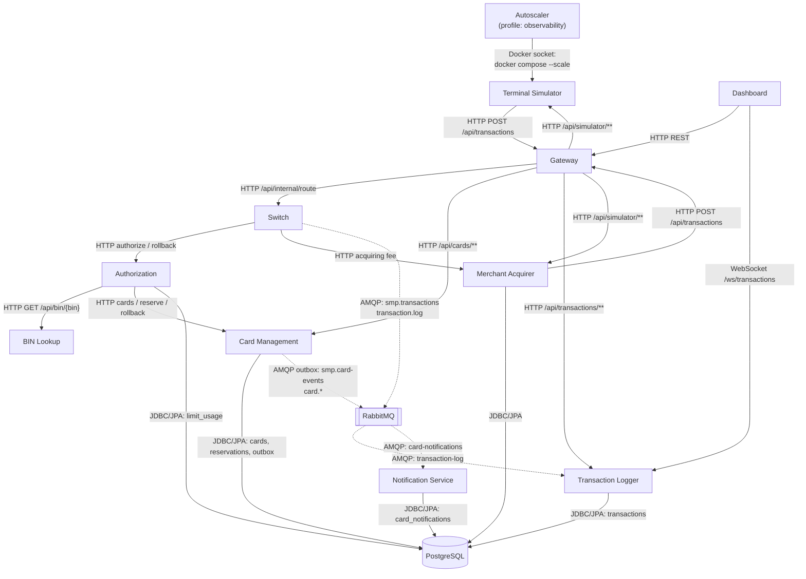

# A2. C4 Level 2 — Container

## Чего не хватало

> Файл `architecture-diagram.puml` есть, но он **не различает sync/async**: все стрелки выглядят одинаково. Не отражены async-пути: Switch → RabbitMQ → Logger (publisher confirms) и Card-Management outbox → RabbitMQ → Notification. Плюс схему стоит сверить с `docker-compose.yaml` — там полный список сервисов и портов.

Ну, почти. Существующие PlantUML- и Mermaid-схемы уже показывали высокоуровневые пути Switch → RabbitMQ → Logger и Card Management → RabbitMQ → Notification, а outbox был упомянут в старой sequence-диаграмме. Однако связи не были явно разделены на синхронные HTTP/JDBC и асинхронные AMQP, а также не были показаны exchange, queue, publisher confirms и внутренний outbox-процессор. Состав сервисов и порты также требовали сверки с `docker-compose.yaml`.

## Что сделано

**В коде:**

- Полный перечень контейнеров, URL и зависимости: [`docker-compose.yaml`](../../../docker-compose.yaml).
- Маршруты Gateway: [`application.yml`](../../../services/gateway/src/main/resources/application.yml).
- Оркестрация Switch: [`RouteService.java`](../../../services/switch/src/main/java/com/processing/service/RouteService.java).
- HTTP-клиенты Authorization: [`CardManagementClientImpl.java`](../../../services/authorization/src/main/java/com/processing/authorization/client/CardManagementClientImpl.java), [`BinLookupClient.java`](../../../services/authorization/src/main/java/com/processing/authorization/client/BinLookupClient.java).
- Публикация Switch в RabbitMQ: [`LoggerClient.java`](../../../services/switch/src/main/java/com/processing/service/LoggerClient.java).
- Outbox Card Management: [`OutboxProcessor.java`](../../../services/card-management/src/main/java/com/processing/cardmanagement/services/OutboxProcessor.java), [`OutboxEventProcessorImpl.java`](../../../services/card-management/src/main/java/com/processing/cardmanagement/services/OutboxEventProcessorImpl.java).
- Consumers: [`TransactionLogListener.java`](../../../services/transaction-logger/src/main/java/com/processing/transactionlogger/listener/TransactionLogListener.java), [`CardEventListener.java`](../../../services/notification-service/src/main/java/com/processing/notification/listener/CardEventListener.java).
- Работа Autoscaler: [`autoscaler.sh`](../../../scripts/autoscaler.sh).

Autoscaler дополнительно опрашивает Prometheus по HTTP, но Prometheus относится к опциональной observability-инфраструктуре и не входит в требуемые 11 прикладных сервисов.

**В итоге:**
показаны 11 объявленных прикладных сервисов, PostgreSQL и RabbitMQ. Сплошные стрелки обозначают синхронные HTTP/JDBC/WebSocket-взаимодействия, а пунктирные — асинхронный AMQP. `autoscaler` помечен как опциональный сервис профиля `observability` и без этого профиля основной Compose запускает 10 прикладных сервисов.

Благодаря этой диаграмме мы видим, какие связи синхронные (тестируем контракт), а какие асинхронные (тестируем очередь и eventual consistency).

