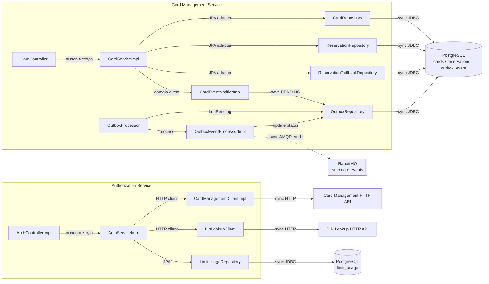

# A3. C4 Level 3 — Component

## Чего не хватало

> Компонентного уровня нет вообще: в документации нет схемы «что внутри сервиса». Нужно дорисовать с нуля, читая пакеты `services/authorization/...` и `services/card-management/...`.

Общая архитектурная схема показывала Authorization и Card Management только как отдельные сервисы, но не раскрывала их контроллеры, бизнес-логику, HTTP-клиенты, репозитории и outbox-процессор.

## Что сделано

**В коде:**

**Authorization**

- Контроллер делегирует в сервис: [`AuthControllerImpl.java`](../../../services/authorization/src/main/java/com/processing/authorization/controller/AuthControllerImpl.java).
- Бизнес-логика и зависимости: [`AuthServiceImpl.java`](../../../services/authorization/src/main/java/com/processing/authorization/services/AuthServiceImpl.java).
- HTTP к Card Management: [`CardManagementClientImpl.java`](../../../services/authorization/src/main/java/com/processing/authorization/client/CardManagementClientImpl.java).
- HTTP к BIN Lookup: [`BinLookupClient.java`](../../../services/authorization/src/main/java/com/processing/authorization/client/BinLookupClient.java).
- Доступ к `limit_usage`: [`LimitUsageRepository.java`](../../../services/authorization/src/main/java/com/processing/authorization/repositories/LimitUsageRepository.java).

**Card Management**

- REST-контроллер CRUD/reserve/rollback: [`CardController.java`](../../../services/card-management/src/main/java/com/processing/cardmanagement/controllers/CardController.java).
- Бизнес-логика: [`CardServiceImpl.java`](../../../services/card-management/src/main/java/com/processing/cardmanagement/services/CardServiceImpl.java).
- Сохранение карточного события в outbox: [`CardEventNotifierImpl.java`](../../../services/card-management/src/main/java/com/processing/cardmanagement/events/CardEventNotifierImpl.java).
- Периодическое чтение outbox: [`OutboxProcessor.java`](../../../services/card-management/src/main/java/com/processing/cardmanagement/services/OutboxProcessor.java).
- Публикация и смена статуса события: [`OutboxEventProcessorImpl.java`](../../../services/card-management/src/main/java/com/processing/cardmanagement/services/OutboxEventProcessorImpl.java).

В итоге: для двух сервисов показан путь от HTTP-контроллера к бизнес-логике и инфраструктурным зависимостям. Синхронные вызовы обозначены сплошными стрелками, асинхронная публикация — пунктирной.

Эта диаграмма пригодится выбора тестовых двойников: где stub/mock (HTTP-клиенты), а где настоящая зависимость (репозиторий, очередь).

