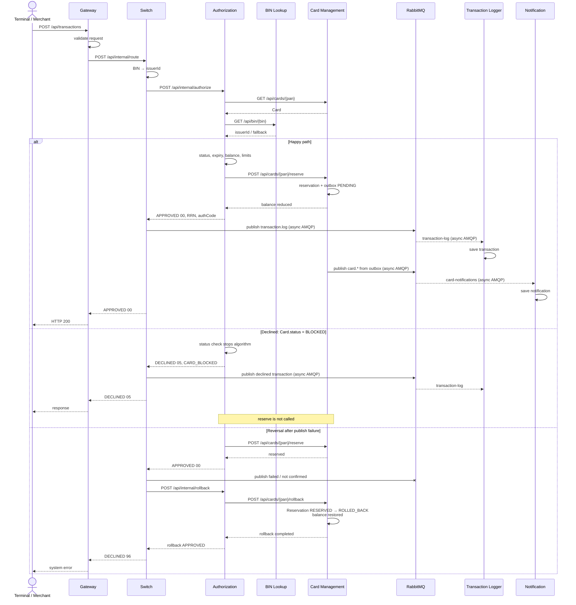

# A4. Sequence — путь транзакции

## Чего не хватало

> Mermaid sequence в `architecture.md` покрывает только happy path. Нет declined и reversal, хотя в коде есть и `DeclineOutcome` (все ветки отказа), и `publisherConfirmType=CORRELATED` с откатом. Эти два сценария — самые ценные для тестирования, и их надо дорисовать.

Почти. Исходная sequence-диаграмма уже содержала обобщённые ветки `approved` и `declined`. В ней не были раскрыты конкретный отказ для карты в статусе `BLOCKED`, сценарий ошибки публикации и последующий rollback, а также граница между синхронной обработкой и асинхронной доставкой. Кроме того, фактический код выполняет откат через `POST /api/internal/rollback`, а не отправкой сообщения с `mti=0400`. Также настройка correlated publisher confirms присутствует, но ожидание подтверждения в течение двух секунд не реализовано.

## Что сделано

В ТЗ откат назван reversal с `mti=0400`, но в текущем коде Switch вызывает отдельный `POST /api/internal/rollback` с `RollbackRequest`, в котором поля `mti` нет. Метод `AuthorizationRequest.forReversal()` создаёт `0400`, но в данном пути не вызывается.

Также конфигурация включает correlated publisher confirms, однако `LoggerClient` выполняет `convertAndSend` без `CorrelationData` и явного ожидания подтверждения 2 секунды. Фактический rollback запускается только при синхронном `AmqpException`.

**По коду:**

- Валидация входного запроса: [`TransactionValidationFilter.java`](../../../services/gateway/src/main/java/com/processing/gateway/validation/TransactionValidationFilter.java).
- Полная оркестрация, публикация и rollback: [`RouteService.java`](../../../services/switch/src/main/java/com/processing/service/RouteService.java).
- HTTP authorize/rollback: [`AuthorizationClient.java`](../../../services/switch/src/main/java/com/processing/service/AuthorizationClient.java).
- Публикация без явного ожидания confirm: [`LoggerClient.java`](../../../services/switch/src/main/java/com/processing/service/LoggerClient.java).
- Проверки карты и резервирование: [`AuthServiceImpl.java`](../../../services/authorization/src/main/java/com/processing/authorization/services/AuthServiceImpl.java).
- Резервирование и возврат баланса: [`CardServiceImpl.java`](../../../services/card-management/src/main/java/com/processing/cardmanagement/services/CardServiceImpl.java).
- Формат rollback-запроса: [`RollbackRequest.java`](../../../services/common/src/main/java/com/processing/common/dto/authorization/RollbackRequest.java).
- Неиспользуемое создание `mti=0400`: [`AuthorizationRequest.java`](../../../services/common/src/main/java/com/processing/common/dto/authorization/AuthorizationRequest.java).

**В итоге:** в одной диаграмме показаны happy path, declined для карты `BLOCKED` и откат резервирования при ошибке публикации. Сплошные сообщения — синхронные HTTP-вызовы, сообщения к RabbitMQ и от него — асинхронный AMQP.

Благодаря этой диаграмме мы видим, какие проверки можно сделать на нижних уровнях, а что требует полного контура.

