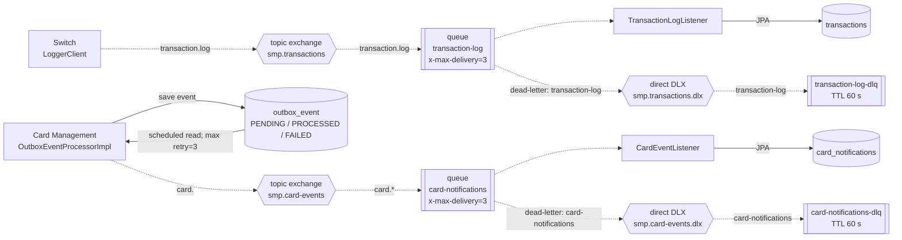

# A5. RabbitMQ-топология

## Чего не хватало

> В `docs/architecture.md` есть **таблица** топологии и текстовое описание, но нет **диаграммы**. Визуализация нужна, чтобы одним взглядом видеть путь сообщения и место отказа.

Общие архитектурные схемы уже показывали высокоуровневые асинхронные пути, но не визуализировали полную цепочку `producer –> exchange –> queue –> consumer –> БД`, привязки routing key, DLX/DLQ, retry и TTL. Настройка correlated publisher confirms присутствовала, при этом отдельная логика ожидания подтверждения в течение двух секунд в коде отсутствовала.

## Что сделано

`publisher-confirm-type=correlated` включён у Switch и Card Management. В ТЗ таймаут подтверждения — 2 секунды, но в фактическом producer-коде нет callback/`CorrelationData`/ожидания confirm: оба producer вызывают `convertAndSend`, поэтому схема отделяет настроенный механизм от реализованной обработки подтверждения. У Switch значение `logger-read-timeout-ms=2000` относится к HTTP-настройкам и не используется как таймаут AMQP confirm.

Outbox обрабатывается раз в 1 секунду, при ошибке увеличивается `retryCount`, а после третьей ошибки событие получает `FAILED` (это отдельный retry producer-а). `x-max-delivery=3` относится к доставке consumer-у, после чего сообщение маршрутизируется в DLX/DLQ.

**По коду:**

- Топология транзакций и DLQ: [`RabbitMQConfig.java`](../../../services/switch/src/main/java/com/processing/config/RabbitMQConfig.java).
- Публикация транзакции: [`LoggerClient.java`](../../../services/switch/src/main/java/com/processing/service/LoggerClient.java).
- Consumer транзакций: [`TransactionLogListener.java`](../../../services/transaction-logger/src/main/java/com/processing/transactionlogger/listener/TransactionLogListener.java).
- Топология карточных событий: [`RabbitMQConfig.java`](../../../services/card-management/src/main/java/com/processing/cardmanagement/config/RabbitMQConfig.java).
- Outbox retry и публикация: [`OutboxEventProcessorImpl.java`](../../../services/card-management/src/main/java/com/processing/cardmanagement/services/OutboxEventProcessorImpl.java), [`application.properties`](../../../services/card-management/src/main/resources/application.properties).
- Consumer карточных событий и сохранение уведомления: [`CardEventListener.java`](../../../services/notification-service/src/main/java/com/processing/notification/listener/CardEventListener.java).
- Correlated confirms Switch: [`application.yml`](../../../services/switch/src/main/resources/application.yml).

**В итоге:** показаны обе AMQP-цепочки, routing key, consumers, dead-letter-маршруты, ограничение в три доставки и TTL DLQ 60 секунд.

Это пригодится для интеграционных тестов с очередями: где проверять доставку, где — retry, где — DLQ.