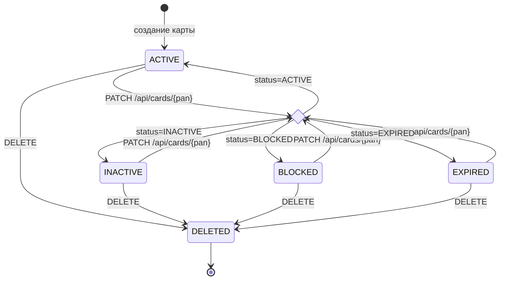
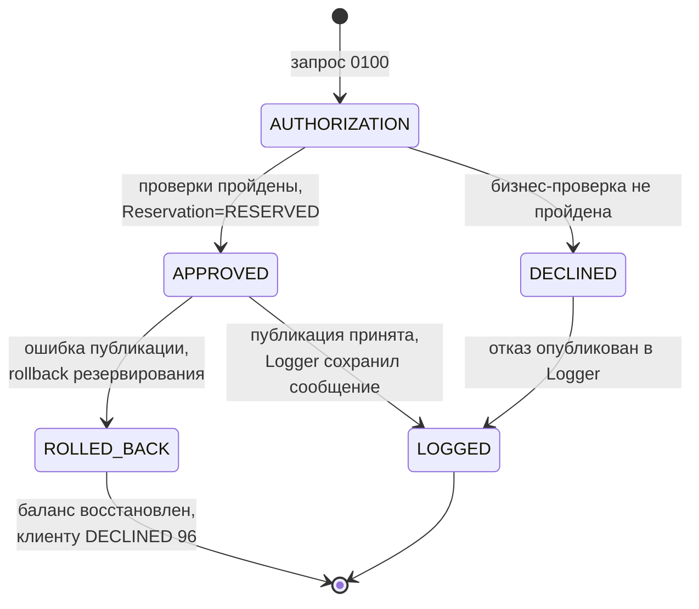

# A6. State-transition

## Чего не хватало

> State-диаграмм нет. Есть enum `CardStatus.java` и логика `authorize()` — из них и собирается диаграмма.

Ззначения состояний и связанная бизнес-логика существовали в коде, но переходы не были представлены диаграммой. При этом `APPROVED` и `DECLINED` относятся к `TransactionStatus`, а `ROLLED_BACK` — к `ReservationStatus`, поэтому жизненный цикл транзакционной операции собирается из состояний двух связанных сущностей.

## Что сделано

### Card.status

`Card.withData()` не ограничивает переходы между `ACTIVE`, `INACTIVE`, `BLOCKED` и `EXPIRED`: допустим любой исходный рабочий статус и любой из четырёх целевых статусов. 

При этом `DELETED` устанавливается только методом `deleted()` и скрывается JPA-фильтром.

### Transaction и Reservation

В модели Transaction Logger enum `TransactionStatus` содержит только `APPROVED` и `DECLINED`, а запись транзакции после сохранения не изменяется. `ROLLED_BACK` — фактическое состояние `ReservationStatus`. На диаграмме оно показано как логическое завершение операции после отмены ранее одобренного резервирования, а не как значение столбца `transactions.status`.

**В коде:**

- Состояния карты: [`CardStatus.java`](../../../services/card-management/src/main/java/com/processing/cardmanagement/models/CardStatus.java).
- Изменение статуса и soft delete: [`Card.java`](../../../services/card-management/src/main/java/com/processing/cardmanagement/models/Card.java), [`CardServiceImpl.java`](../../../services/card-management/src/main/java/com/processing/cardmanagement/services/CardServiceImpl.java).
- Скрытие `DELETED`: [`CardEntity.java`](../../../services/card-management/src/main/java/com/processing/cardmanagement/models/CardEntity.java).
- Результаты авторизации транзакции: [`TransactionStatus.java`](../../../services/common/src/main/java/com/processing/common/dto/transactionlogger/TransactionStatus.java).
- Состояния резервирования: [`ReservationStatus.java`](../../../services/card-management/src/main/java/com/processing/cardmanagement/models/ReservationStatus.java), [`Reservation.java`](../../../services/card-management/src/main/java/com/processing/cardmanagement/models/Reservation.java).
- Триггер rollback: [`RouteService.java`](../../../services/switch/src/main/java/com/processing/service/RouteService.java).
- Неизменяемая после сохранения Transaction: [`Transaction.java`](../../../services/transaction-logger/src/main/java/com/processing/transactionlogger/model/Transaction.java).

**В итоге:** показаны рабочие состояния карты, soft delete и логический жизненный цикл транзакционной операции с состоянием резервирования при rollback.

Такая диаграмма пригодится для E2E-сценариев: переходы состояний напрямую дают сквозные сценарии (заблокировали карту → транзакция отклонена; истёк срок → DECLINED с кодом 54).