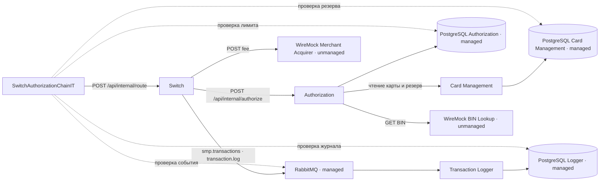

# Практика 6. Интеграционные тесты СМП

## 1. Граница уровней
### 1.1. Что проверяем на каждом уровне

Юнит-тесты практики 4 проверяют решения сервисов при заданных ответах зависимостей. Например, `AuthServiceImplLimitsTest` подставляет результаты `upsertLimitUsage` и проверяет решение Authorization при успешном обновлении или превышении лимита. 
А интеграционный тест `LimitUsageRepositoryIT` запускает тот же запрос на PostgreSQL и проверяет число обновлённых строк и сохранённые суммы. Такой тест, в отличии от юнит-теста – обнаруживает ошибки в SQL, маппинге схемы и границах транзакций.

На уровне юнит-тестов осталась логика принятия решений. В `AuthServiceImplLimitsTest` мок возвращает `0`, и тест проверяет, что Authorization отклоняет операцию и не запрашивает резерв. Другие сценарии проверяют выбор даты в UTC и поведение при повторной попытке после конфликта. В Card Management юнит-тесты проверяют правила резервирования, например отказ при недостаточном балансе или неактивной карте.

На интеграционном уровне проверяем, **при каких данных сам `upsertLimitUsage` вернёт `1` или `0`**. PostgreSQL должен вставить первую строку, при повторном вызове обновить ту же пару `(pan, usage_date)` без дубликата и пересчитать дневную и месячную суммы. Например, при дневном лимите `100` операция, доводящая сумму ровно до `100`, проходит. Следующая операция на `1` возвращает `0`, а чтение в отдельной транзакции подтверждает, что обе сохранённые суммы остались прежними. Если из ветки `ON CONFLICT` убрать проверку накопленной дневной суммы, этот интеграционный тест упадёт. Юнит-тест с моком по-прежнему получит заданный `0` и подтвердит реакцию сервиса на отказ.

API-тесты практики 5 проверяют HTTP-контракты. В практике 6 же один успешный запрос проходит через реальные сервисы, а результат подтверждается событием в RabbitMQ и прямым чтением трёх БД. Отдельный брокерный тест проверяет передачу неконвертируемого сообщения в DLQ и обработку следующего сообщения тем же потребителем.

### 1.2. Эксперимент с H2

Во временной копии запустили те же проверки карт на H2 2.3.232 с `MODE=PostgreSQL`.

| Проверка | PostgreSQL 16 | H2 2.3.232 |
|---|---|---|
| Flyway на пустой БД | V5.1–V5.8 применяются | V5.8 останавливается на `WHERE status != 'DELETED'`, SQLSTATE `42000`. Отдельное выполнение этого `CREATE UNIQUE INDEX` даёт ту же синтаксическую ошибку |
| Round-trip | Пройден на схеме Flyway | Пройден на схеме Hibernate `create-drop` с отключённым Flyway |
| Дубликат `ACTIVE` | Адаптер выбрасывает `PanCollisionException` | Адаптер выбрасывает `PanCollisionException` на схеме Hibernate |
| Новый `ACTIVE` с PAN карты `DELETED` | Создаётся, обе записи остаются в БД | Создание отклонено с `PanCollisionException` на схеме Hibernate из-за уникальности PAN для всей таблицы |

**Почему H2 это не поймал бы.** В PostgreSQL Flyway применяет V5.8 и создаёт частичный уникальный индекс `uk_cards_pan` с условием `WHERE status != 'DELETED'`. H2 даже в режиме совместимости с PostgreSQL отклоняет этот `WHERE` с ошибкой `42000`. Чтобы запустить проверки на H2, во временной копии отключили Flyway и создали схему через Hibernate с `ddl-auto=create-drop`. На этой схеме round-trip прошёл, а обычное ограничение уникальности PAN по-прежнему отклонило дубликат `ACTIVE`. Оно распространяется и на строки `DELETED`, поэтому повторное использование PAN удалённой карты тоже завершилось `PanCollisionException`. На PostgreSQL новая активная карта с таким PAN успешно создаётся, и обе строки остаются в БД. Именно этот сценарий выявил различие, которое скрыли два зелёных теста на H2.

## 2. Persistence-checklist

| Проверка | Где проверяется |
|---|---|
| Round-trip и маппинг | `CardRepositoryIT.roundTripsCardThroughMigratedDatabase` читает карту в новой транзакции и сравнивает все поля. |
| Ограничения целостности | `CardRepositoryIT` проверяет отказ для второго `ACTIVE`, сохранность первой записи и успешное создание новой `ACTIVE` при наличии `DELETED` с тем же PAN. |
| Миграции на пустой БД | В Card Management старт JPA-среза на новом контейнере применяет V5.1–V5.8 с `ddl-auto=validate`. Logger тоже запускается со своими миграциями Flyway. Таблицу `limit_usage` в Authorization создаёт Hibernate с `ddl-auto=update`, а Flyway создаёт `rrn_seq`. |
| SQL диалекта PostgreSQL | `LimitUsageRepositoryIT` проверяет `INSERT … ON CONFLICT`, накопление сумм, дневной предел и перенос месячной суммы между датами. |
| Транзакционность | После конфликта PAN запись читается отдельно и остаётся прежней. Upsert сверх лимита возвращает `0`, ранее сохранённые строки и суммы совпадают. Сквозной тест подтверждает видимость коммитов через отдельные JDBC-соединения. |

`TransactionLoggerDlqIT` сохраняет `messageId` и тело poison message при проверке DLQ и проверяет причину `rejected` в `x-death`. Отдельная очередь трассировки на тестовом брокере фиксирует одну фактическую доставку в `transaction-log`, включая возможные повторные доставки. После этого корректный `TransactionRequest` сохраняется в БД с ожидаемыми UUID, RRN, STAN и статусом.

## 3. Стратегия изоляции

- Статические `@Container` ограничивают время жизни Docker-ресурсов одним классом. В JPA и Spring Boot тестах `@ServiceConnection` подставляет параметры контейнеров. Сквозной тест поднимает приложения из JAR текущей Maven-сборки в отдельной сети со случайными портами хоста и ждёт готовности сервисов. Версии образов PostgreSQL и RabbitMQ совпадают с основным Compose.
- `@BeforeEach` очищает изменяемые таблицы через `TRUNCATE … RESTART IDENTITY CASCADE`, очищает используемые очереди и сбрасывает WireMock. Историю миграций и справочник BIN сохраняем. Каждый сценарий создаёт собственные данные. В репозиторных тестах используется уникальный PAN, в сообщениях — UUID, STAN и RRN, в сквозном тесте PAN и RRN назначают реальные сервисы.
- Подготовка, запись и чтение выполняются отдельно. В JPA-срезах автоматическая транзакция вокруг метода отключена, а операции обёрнуты в `TransactionTemplate`. Сквозной тест проверяет состояние после ответа сервиса и читает результат асинхронной записи через новое соединение.
- Awaitility ограничивает ожидание событий и записей пятью секундами с интервалом 100 мс. Проверки не заглушают ошибки соединения или SQL. TTL DLQ составляет 60 секунд, сообщение читается сразу после появления. Failsafe выполняет тесты последовательно. При сбое сверяем состояние очередей, сервисные логи, данные для конкретной операции и готовность контейнеров.

## 4. Диаграмма цепочки задания 3:



В задании указан `/api/internal/authorize` у Switch. В текущих контроллерах и ТЗ вход Switch — `/api/internal/route`, а `/api/internal/authorize` вызывает сам Switch у Authorization. Входной запрос содержит STAN, RRN выдаёт Authorization. По полученному RRN тест находит резерв, событие и запись журнала. Строка лимита проверяется по PAN и UTC-дате запроса. Журнал WireMock подтверждает реальный вызов обоих HTTP-контрактов.

Полный набор выполняется из корня проекта с JDK 21, Maven и доступным Docker.

```bash
mvn -B -ntp -f services/pom.xml -Pintegration-tests clean verify
```

При локальном Docker через Lima Testcontainers получает `DOCKER_HOST` из активного Docker context и путь `/var/run/docker.sock` для Ryuk внутри VM. Для Docker 29 использован `JAVA_TOOL_OPTIONS=-Dapi.version=1.44`, совместимый с docker-java текущей версии Testcontainers. У job `integration-tests` настроены два последовательных запуска на одном runner и отдельный комплект XML-отчётов Failsafe для каждого прогона.

## 5. Прогоны

| Класс | Прогон 1 | Прогон 2 |
|---|---:|---:|
| `CardRepositoryIT` | 3 из 3 | 3 из 3 |
| `LimitUsageRepositoryIT` | 4 из 4 | 4 из 4 |
| `TransactionLoggerDlqIT` | 1 из 1 | 1 из 1 |
| `SwitchAuthorizationChainIT` | 1 из 1 | 1 из 1 |
| Всего | 9 из 9 | 9 из 9 |

